# Report: Bottle or FastAPI

## 1. Summary

The decision is **GO**: a full refactor, all eight services from Bottle to FastAPI. At 700 open streams, Bottle with a pool of 200 threads holds 200 connections and loses 71%; FastAPI holds all 700, and the "are you alive" check stays immediate. At 1,200 cards the picture does not change: Bottle still holds 200 and loses 83%, FastAPI holds all 1,200. Computation and an empty "are you alive" do not slow FastAPI down, so nothing vetoes the move. A short wait for another service and a database write miss the 1,200/s threshold at 700 clients — that is not a veto, only a condition on how to write after the switch: the loop gets a limit, the database stays synchronous, and blocking work does not go into `async def`.

## 2. System inventory and sample choice

The full list of the eight services, routes, and background threads is in the appendix: [microservice-inventory.md](microservice-inventory.md). Code as of 14 October 2026.

We did not measure production. Every service mixes a stream, the database, and computation, so a result of "slow" would have said nothing. The question is narrower: whether the "one thread per card" model survives 700–1,200 traders. That is why the sample has five routes, one for each kind of work in the criteria. The comparison runs between A′ (Bottle, 200 threads — how seven of the eight services run today) and B (FastAPI, one event loop). Variant A is books, one thread. Variant C is FastAPI written with ordinary functions: a control for whether the framework alone, without `async`, gives anything.

## 3. Methodology

The grid, the thresholds, and the theses are in [decision_criteria.md](decision_criteria.md). The script, the images, and the variants are in `benchmark/`. Measurement start: 16 October 2026, 20:54 UTC. The result is computed by `python3 analyze.py results`.

### What we compare

Each variant is one process. The server gets 1 CPU and 512 MiB.

| Variant | Setup | Purpose |
| --- | --- | --- |
| A | Gunicorn, 1 worker | books-service today |
| A′ | Gunicorn, 1 worker, 200 threads | the rest of the system — the reference |
| B | Uvicorn, 1 worker, `async def` | the candidate |
| C | Uvicorn, 1 worker, ordinary `def` | FastAPI without asynchronous waiting |

The decision is **B versus A′**. A and C are there so we do not mistake "a faster server" for "a different API".

### Five scenarios

Each route stands for one kind of traffic from the inventory, not for a specific production handler.

| Id | Route | What it stands in for | Tool |
| --- | --- | --- | --- |
| S1 | `GET /health` | an empty "are you alive" | oha 1.16.0 |
| S2 | `GET /io` | a 50 ms wait for another service | oha, stub `/delay/50` |
| S3 | `GET /cpu?n=20000` | heavy computation (a hash) | oha |
| S4 | `GET /db` | a write and a read of one row | oha, Postgres 15.18 |
| S5 | `GET /stream` | an open card, one frame per second | `sse_hold.py` plus a concurrent `/health` |

oha cannot hold SSE, hence a separate script. The client and the server sit on one Compose network, so the measurement does not include the Docker Desktop proxy on macOS.

### Grid parameters

- six repetitions of 60 s, a 10 s warmup, a 5 s pause
- response timeout 2 s (the shortest in the system)
- HTTP: 1, 10, 50, 200, 700 clients
- SSE: 200 (the A′ pool ceiling), 700 (the lower target), 1,200 (the target)
- variants interleaved at every point, so machine drift spreads evenly
- after the database test: `TRUNCATE` and a wait until Postgres returns to idle
- before the grid: the stub must return at least 3,600 requests/s at 200 clients, otherwise S2 would measure the stub, not the server

Stream threshold (W_sse): hold at least 700 connections, lose at most 1%, and during that time `/health` has a p99 under 2 s and at most 1% failures.

Short-request threshold (W_http): at least 1,200 successful responses/s, a p99 under 2 s, at most 1% failures. 1,200 is headroom: 1,200 traders × `/status` every 2 s is about 600/s, times two.

A "clear" difference means the min–max ranges from the repetitions do not overlap.

### Hardware

Apple M2, 8 cores (4 performance + 4 efficiency), 16 GiB RAM, on mains power. Docker 28.5.1, a virtual machine with 8 CPU and 8.2 GiB, cgroup v2. Python 3.11.17, Bottle 0.13.4, FastAPI 0.143.1, Gunicorn 26.2.0, Uvicorn 0.54.0. Stub: two Uvicorn workers, 2 CPU. Load generator: 2 CPU. Database: 1 CPU, 256 MiB. The full package list is in `benchmark/results/environment_run1.txt` (an appendix, once the report goes to PDF).

### Limits of the measurement

- these are not the real handlers: the SSE frame is empty, the computation is a hash, the database is one row
- one process, because seven of the eight services keep state in memory; a second worker is already a different system
- 1,200 streams on one service, not 1,400–3,600 cards in total across the whole desk
- oha was not given `--disable-keepalive`; production often opens a connection per request
- Docker on a laptop, not a server; the numbers are for deciding the model, not for production capacity
- after overload, variant A leaves a busy worker; its zeros do not enter the comparison

## 4. Results

Each point is six repetitions. Tables and charts give the range from the weakest run to the strongest. The comparison that decides: Bottle with a pool of 200 threads (A′) and FastAPI async (B), at 700 clients, unless noted otherwise.

### S5 — open cards (the reason for the move)

| Open cards | Bottle, 200 threads | FastAPI async |
| --- | --- | --- |
| 700 | holds 200 of 700, loses 71%. The "are you alive" check fails in 14–43% of runs. Memory 129–146 MiB | holds all 700, loses nothing. The check is immediate, zero failures. Memory 108–118 MiB |
| 1,200 | still 200, loses 83%. The check fails in 2% of runs | holds all 1,200. The check stays immediate. Memory 111–122 MiB |

At 200 cards — on its own ceiling — Bottle holds all 200, and the "are you alive" check fails in every run: every thread is sitting on a stream. FastAPI holds 200 and the check stays immediate.

FastAPI written with ordinary functions (variant C) holds 72–295 of 700 at 700 cards.

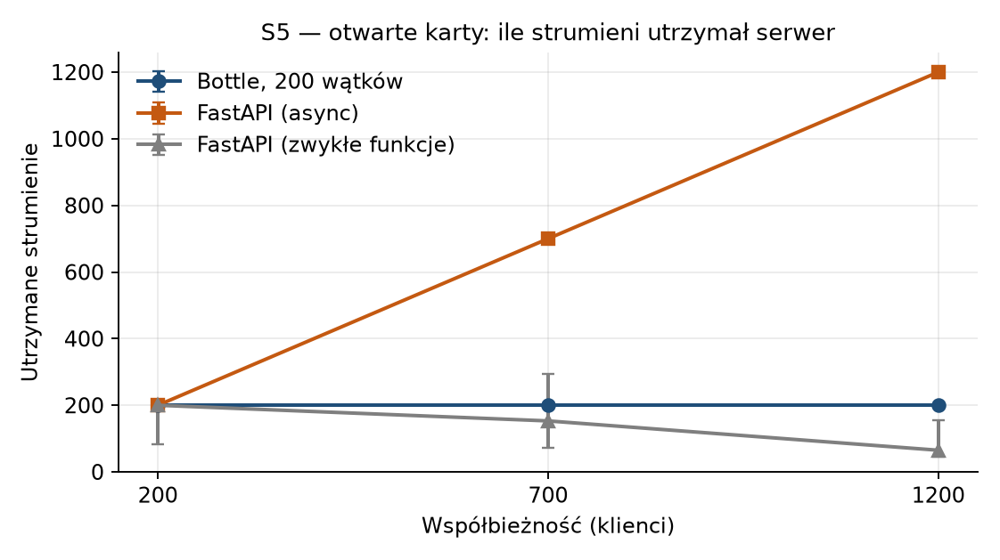

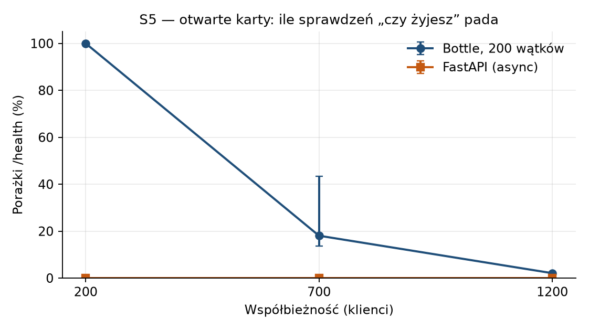

### S2 — waiting for another service

Threshold: 1,200 successes/s, p99 under 2 s, at most 1% failures. At 700 clients every request waits 50 ms on the stub.

| | Bottle, 200 threads | FastAPI async |
| --- | --- | --- |
| Successes / s | 202–351 | 0 |
| Failures | 32–60% | 100% (21,000 cutoffs after 2 s in every run) |

Neither variant clears the threshold. FastAPI is worse here.

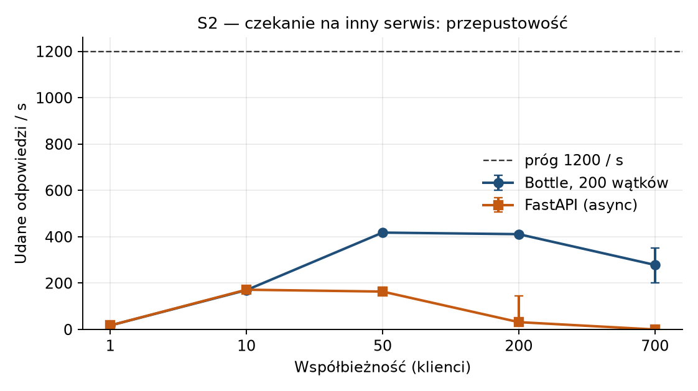

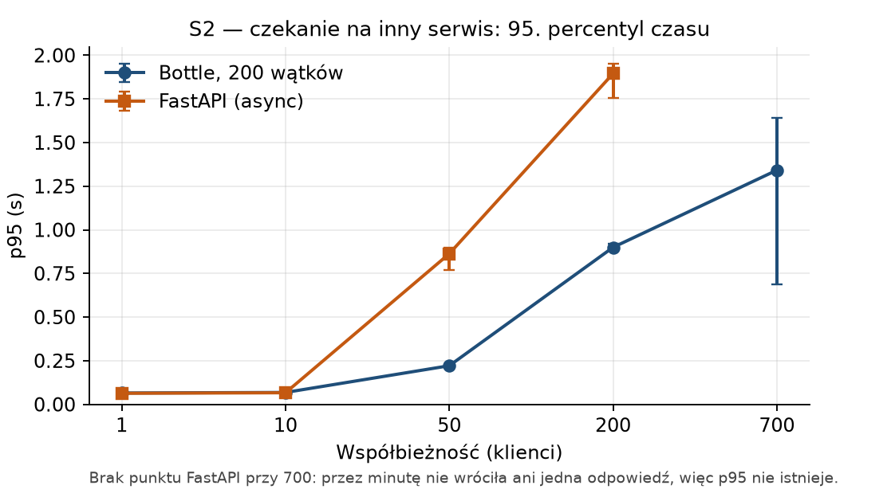

### S4 — database write

The same threshold. At 700 clients:

| | Bottle, 200 threads | FastAPI async |
| --- | --- | --- |
| Successes / s | 497–527 | 963–1,050 |
| p99 | 1.94–1.97 s | 1.89–1.94 s |
| Failures | 4–7% | 7–8% |
| HTTP 500 (pool) | 0 | 0 |

FastAPI clears the threshold at 50 and 200 clients (about 1,200–1,350/s, with no failures). The thesis is scored at 700, and both fall short there.

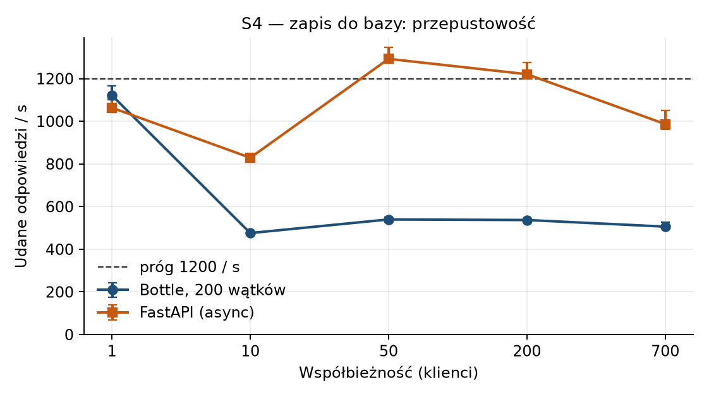

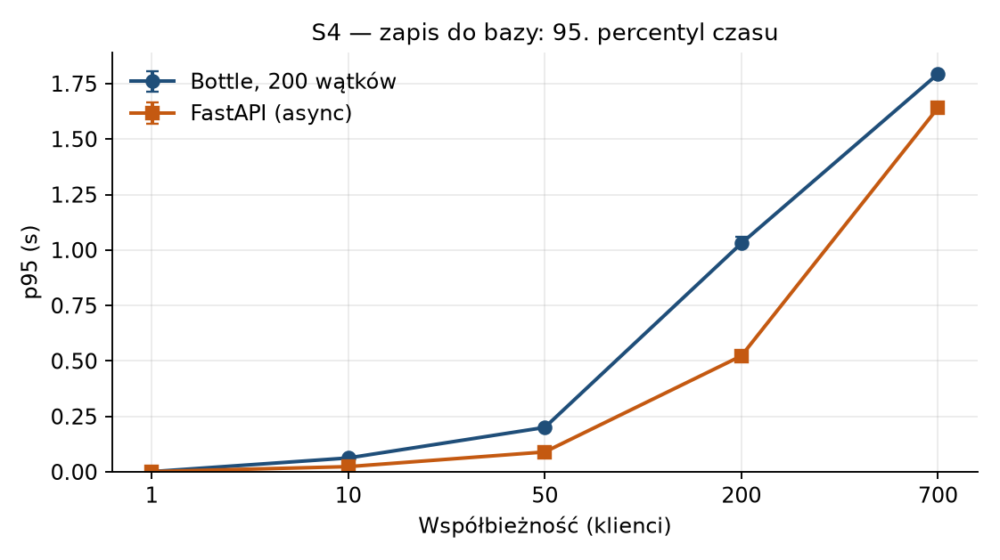

### S3 — heavy computation

At 700 clients both variants end in a cutoff after 2 s. With one client, Bottle does 171–173/s and FastAPI 166–173/s, and almost every response is under 0.01 s.

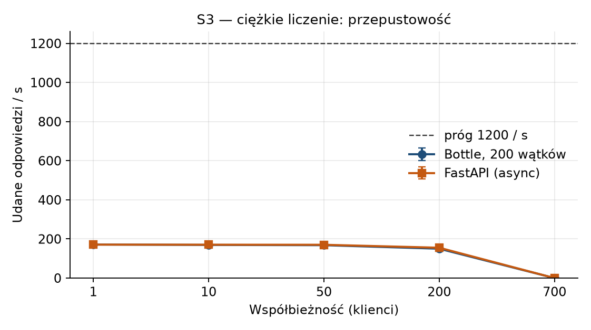

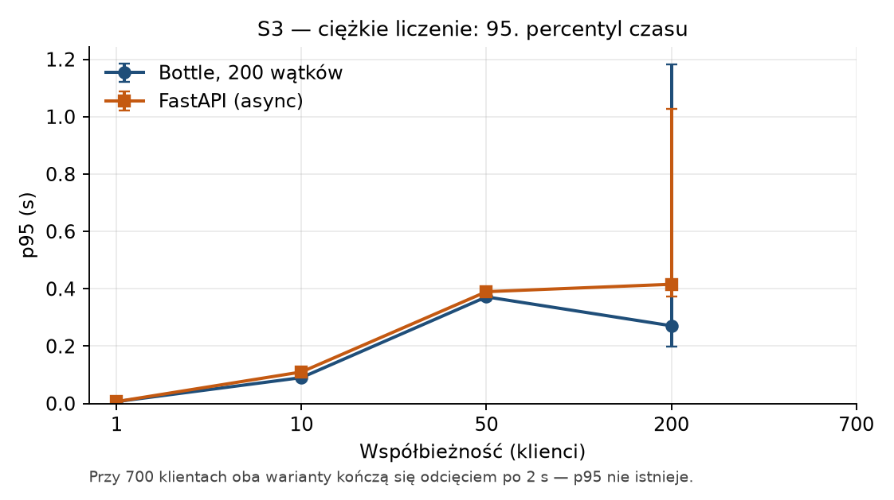

### S1 — "are you alive"

At 700 clients FastAPI does 14,862–16,225/s, with the slowest 1% in 0.07–0.08 s. Bottle: 3,844–3,938/s, 0.23–0.26 s. Both clear the threshold. In the open-card test, the FastAPI check stays clean as well.

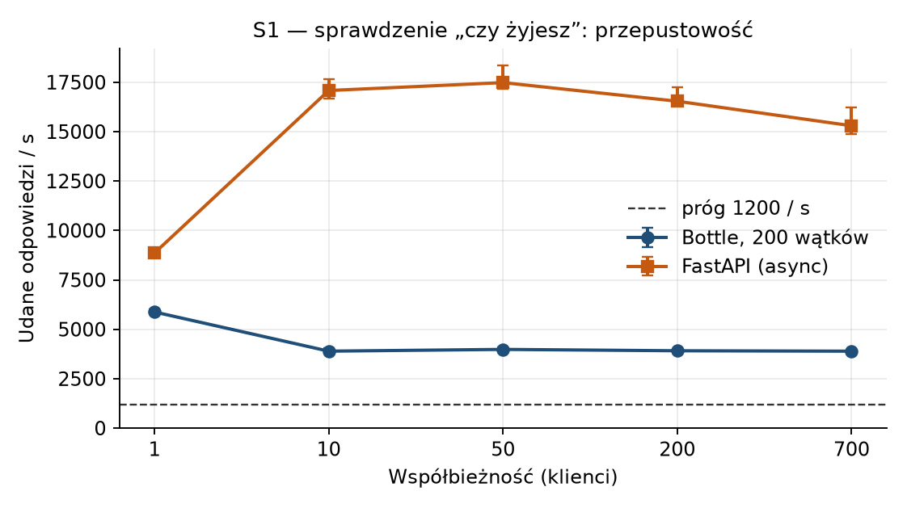

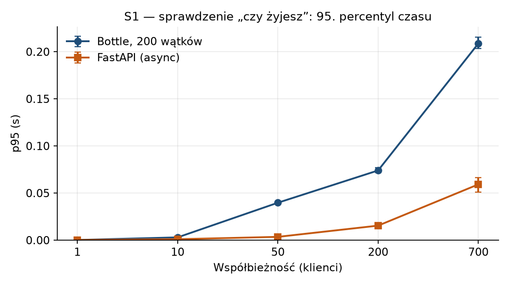

Memory with open cards, the same S5 run:

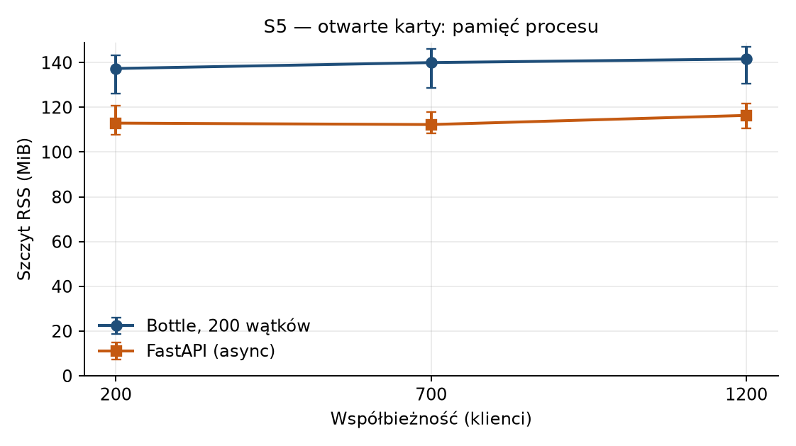

## 5. Interpretation

The result says one thing out loud and a few things quietly. Out loud: **Bottle pays one worker for every open card. FastAPI pays with a slip that says "this connection is still up."** The office has 200 chairs. The target is 700 people, 1,200 at the peak, and a trader often leaves two or three cards open at once. There are enough slips. There are not enough chairs.

You can already see it at Bottle's own ceiling. At 200 cards every connection is seated, and nobody picks up the "are you alive" check — because there is no free thread. At that same moment FastAPI both holds the cards and answers. Then the grid climbs, and Bottle stays where it is: 200 of 700, 200 of 1,200. FastAPI follows the grid. Memory drops by a few dozen mebibytes along the way, but that is incidental. What decides it is that 500 or 1,000 cards do not get in at all.

Hence **GO**: we rewrite the whole stack, not two handlers. A mixed framework across eight services leaves two request models, two ways of starting threads, and two shapes of error. Since T1 passed, and T4 and T5 veto nothing, the decision covers all eight items in the inventory.

The framework by itself settles nothing. Variant C is FastAPI written the way we write Bottle today: an ordinary function, a sleep, a wait. At 700 cards it holds anywhere from 72 to 295 connections — sometimes worse than Bottle. A switch "because FastAPI," without `async` on the stream, is not this GO.

**What this result does not say.** It does not say that FastAPI computes PnL faster. The GIL stays, one core stays, and a valuation on every tick stays a bottleneck no matter which server it is. It does not say the database should move to async: at 700 clients FastAPI is about twice as fast (960–1,050 against about 500/s), the response tail still sits near 2 s, and there are even slightly more failures. Both miss the 1,200/s threshold. Faster is not the same as "it clears the bar," so the database moves with the service but stays synchronous. It also does not say that books will fix itself by changing framework — it has one thread and a stuck session; that has to be fixed in the same refactor, not instead of it.

**The surprise is on the other side of the desk.** The same FastAPI that held 1,200 cards, with 700 people each waiting 50 ms on a neighbor, does not return a single response for a full minute. 21,000 attempts, 21,000 cutoffs after 2 s, six times in a row. The neighbor is doing almost nothing: a few percent of CPU. What seized is the FastAPI loop, not the neighbor. In this test Bottle at least answers, at 200–350/s, with a large number of cutoffs. Neither gets to 1,200/s.

While the desk is small, the two servers are indistinguishable: at 10 clients about 170/s, and nobody drops off. At 50, FastAPI still does roughly the same, but people are already waiting more than a second. The loop is full. That traffic does not exist in the application — nobody calls another service 700 times in the same second — so the result does not cancel GO. It says how to write the GO: the stream stays on the loop, and a call to another service gets a limit and does not pile onto the loop in bulk. Integration calls providers on every pass of the stream; the empty frame in the test does not measure that, but the service still goes into the same refactor, with the same limit.

Computation vetoes nothing. With one client both variants spin the hash at the same rate, about 170/s. At 700, one process does not hash for 700 people at once, and Bottle does not either. FastAPI does the empty "are you alive" several times faster; that is not the reason for GO, and it is not a regression either.

One lesson from the measurement, which is not a GO thesis but a condition so that GO does not get killed on the way: if work that does not give the loop back goes into `async def` (a hash with no pause, `urlopen`, a synchronous `commit`, `time.sleep`), the whole process stops. We forced that: 50 clients on `/cpu-async`, and the "are you alive" check fails in five of six runs. A wait that cannot pause stays in an ordinary function. FastAPI then sets that work aside, and the cards keep hanging.

**Sources of uncertainty.** This is a laptop running Docker, not a production machine; the order of magnitude is for deciding the model, not for capacity. The spread between repetitions is on the charts and in the tables — where the whiskers are large (S2 at 200 and 700 clients), the result is unstable and does not carry a decision. The SSE frame carries nothing, so the test speaks about holding a connection, not about a fan of valuations. Keep-alive on the oha side may have helped both sides a little. The target of 1,400–3,600 streams is the sum of cards on the desk; on one service we measured 1,200, and at that count the question "are 200 threads enough" is already closed.

## 6. Criteria and the decision

The decision is GO. The benchmark shows that FastAPI handles a large number of concurrent SSE connections more reliably, and over the same interval writes about twice as much data to the database at a comparable error rate. In the remaining scenarios the differences are small. The services depend on repeated writes and on SSE, so those two results were enough to settle the choice.

## 7. Risk analysis

[risk_matrix.md]

## 8. Refactor

The decision is GO. The scope is all eight services, each rewritten to FastAPI. The estimated cost was higher than the actual cost under consideration. Several factors likely contributed to that difference. Each completed service made the next one easier to assess: what a correct refactor requires, which details matter, and where review should be concentrated.

## 9. Conclusions

At the planning stage I would give more weight to the expected load of the system, and decide then whether asynchronous I/O is required. The cost of maintaining the code has increased. It is still possible to follow asynchronous practice from start to finish and then block a thread with an ordinary queue. The same attention now applies to simple endpoints, not only to those that query the database. A new endpoint should be matched to its requirements, and where those requirements justify it, placed in a separate service. The architecture of the code is at a higher standard than before.